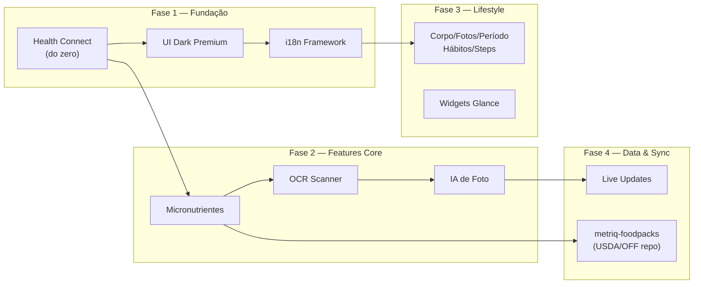
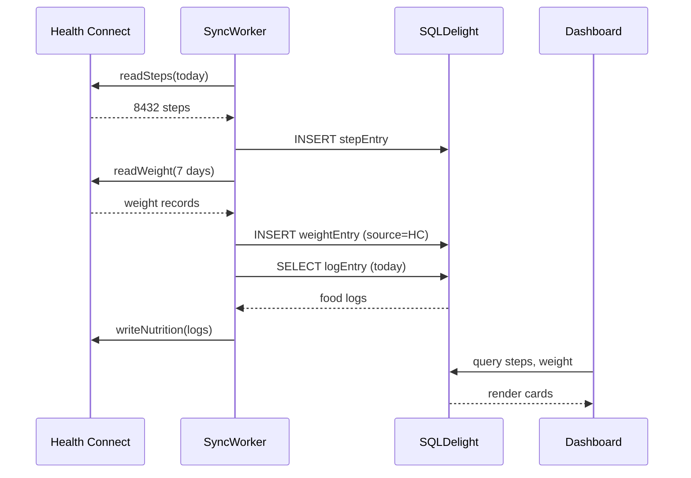
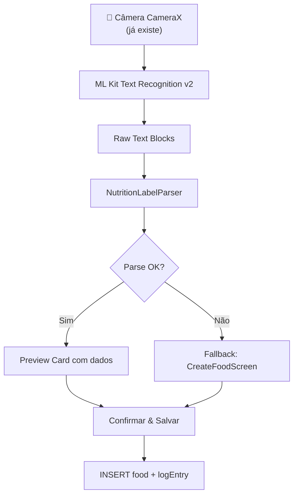
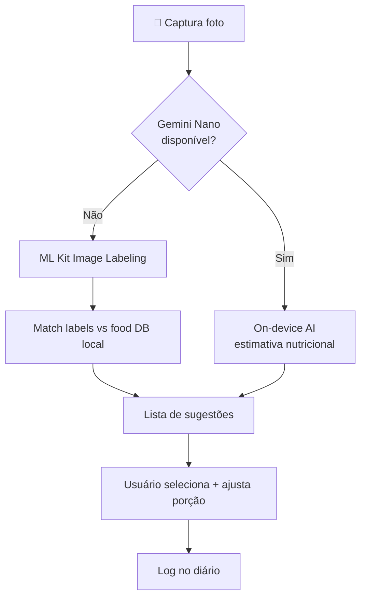
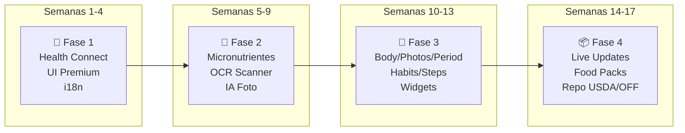

# 🚀 Metriq Evolution Plan — v2.0

> **Status**: Draft — Aguardando aprovação
> **Data**: 2026-11-22
> **Versão atual**: 0.1.0 (versionCode 1)

---

## Sumário Executivo

Este plano transforma o Metriq de um tracker de macros offline funcional em um **app premium de saúde & nutrição** no nível do MacroFactor/Cronometer. São **10 workstreams** organizados em **4 fases**.

### Arquitetura Atual (Auditada)

| Aspecto | Realidade |
|---|---|
| **Módulos** | `:app` · `:core-domain` (JVM puro) · `:core-data` (Android lib) |
| **UI** | 100% Jetpack Compose + Material 3, edge-to-edge |
| **Navegação** | `enum Screen` com `rememberSaveable` (sem Navigation Compose) |
| **DB** | **SQLDelight 2.1.0** com `AndroidSqliteDriver` + FTS5 |
| **DI** | Manual: `object AppGraph` → `MetriqStore` |
| **Networking** | **Zero** — sem internet, sem Retrofit, sem OkHttp |
| **Barcode** | CameraX + ML Kit Barcode Scanning (lookup local) |
| **Food DB** | TSV estático (~53 foods) + `build_pack.py` para OFF |
| **Health Connect** | **❌ Não existe** |
| **Tipografia** | `FontFamily.Default`, SemiBold, tight letter-spacing |
| **Paleta** | Monochrome preto/branco, macros em coral/verde/dourado |
| **Background Work** | Nenhum (sem WorkManager) |

### Schema Já Existente (Sem UI/Repo)

O `Metriq.sq` já define **17 tabelas**. Muitas são schema-only (sem repository nem UI):

| Tabela | Repo | UI | Status |
|---|---|---|---|
| `profile` | ✅ | ✅ | Funcional |
| `weightEntry` | ✅ | ✅ | Funcional |
| `food` + FTS5 | ✅ | ✅ | Funcional |
| `logEntry` | ✅ | ✅ | Funcional |
| `checkin` | ✅ | ✅ | Funcional |
| `settings` | ✅ | Parcial | Funcional |
| `recipe` / `recipeItem` | ❌ | ❌ | Schema only |
| `dayProperty` | ❌ | ❌ | Schema + queries |
| `bodyMeasurement` | ❌ | ❌ | Schema only |
| `progressPhoto` | ❌ | ❌ | Schema only |
| `habit` / `habitLog` | ❌ | ❌ | Schema only |
| `stepEntry` | ❌ | ❌ | Schema + queries |
| `waterEntry` | ❌ | ❌ | Schema + queries |
| `nutrientTarget` | ❌ | ❌ | Schema only |
| `program` | ❌ | ❌ | Schema only |
| `exportJob` | ❌ | ❌ | Schema only |
| `aiRequest` | ❌ | ❌ | Schema only |

> [!TIP]
> Muitas das tabelas já existem no schema — o trabalho é criar **repositories**, **ViewModels** e **UI composables**, não redesenhar o banco.



---

## Índice

1. [Health Connect — Integração Completa (do Zero)](#1-health-connect--integração-completa-do-zero)
2. [UI/UX Dark Premium](#2-uiux-dark-premium)
3. [Scanner OCR de Rótulos](#3-scanner-ocr-de-rótulos)
4. [IA de Reconhecimento de Foto](#4-ia-de-reconhecimento-de-foto)
5. [Widgets Glance](#5-widgets-glance)
6. [Tela de Micronutrientes](#6-tela-de-micronutrientes)
7. [Corpo / Fotos / Período / Hábitos / Steps](#7-corpo--fotos--período--hábitos--steps)
8. [Live Updates](#8-live-updates)
9. [i18n — Internacionalização](#9-i18n--internacionalização)
10. [metriq-foodpacks — USDA/OFF Offline Repo](#10-metriq-foodpacks--usdaoff-offline-repo)
11. [Plano de Fases & Timeline](#11-plano-de-fases--timeline)
12. [Verificação & Testes](#12-verificação--testes)

---

## 1. Health Connect — Integração Completa (do Zero)

### 1.1 Estado Atual

**Health Connect não existe no Metriq.** Zero dependências, zero permissões, zero código.

Porém, o schema SQLDelight já suporta conceitos relevantes:

```sql
-- weightEntry já tem campo source (pode ser 'health_connect')
CREATE TABLE weightEntry (
  ...
  source TEXT NOT NULL DEFAULT 'manual',
  ...
);

-- stepEntry já tem campo source
CREATE TABLE stepEntry (
  date TEXT PRIMARY KEY,
  steps INTEGER NOT NULL,
  source TEXT NOT NULL DEFAULT 'manual'
);
```

> [!IMPORTANT]
> Como o Metriq é **offline-first sem internet**, a integração Health Connect será a **primeira feature que conecta o app com dados externos do device**. Isso é uma mudança filosófica — devemos manter o princípio "local-first" e tratar o HC como outra fonte local.

### 1.2 Implementação Proposta

#### Dependências

```toml
# gradle/libs.versions.toml
[versions]
healthConnect = "1.1.0-alpha11"
work = "2.9.1"

[libraries]
health-connect = { group = "androidx.health.connect", name = "connect-client", version.ref = "healthConnect" }
work-runtime = { group = "androidx.work", name = "work-runtime-ktx", version.ref = "work" }
```

```kotlin
// app/build.gradle.kts
implementation(libs.health.connect)
implementation(libs.work.runtime)
```

#### [NEW] `app/.../health/HealthConnectManager.kt`

```kotlin
class HealthConnectManager(private val context: Context) {

    private val client by lazy { HealthConnectClient.getOrCreate(context) }

    val permissions = setOf(
        HealthPermission.getReadPermission(StepsRecord::class),
        HealthPermission.getReadPermission(TotalCaloriesBurnedRecord::class),
        HealthPermission.getReadPermission(ActiveCaloriesBurnedRecord::class),
        HealthPermission.getReadPermission(WeightRecord::class),
        HealthPermission.getReadPermission(ExerciseSessionRecord::class),
        HealthPermission.getWritePermission(WeightRecord::class),
        HealthPermission.getWritePermission(NutritionRecord::class),
    )

    fun isAvailable(): Boolean =
        HealthConnectClient.getSdkStatus(context) == SDK_STATUS_AVAILABLE

    suspend fun hasAllPermissions(): Boolean = /* ... */

    // READ
    suspend fun readSteps(date: LocalDate): Long
    suspend fun readCaloriesBurned(date: LocalDate): Double
    suspend fun readActiveCaloriesBurned(date: LocalDate): Double
    suspend fun readWeight(days: Int = 30): List<Pair<LocalDate, Double>>
    suspend fun readExerciseSessions(date: LocalDate): List<ExerciseData>

    // WRITE
    suspend fun writeWeight(date: LocalDate, kg: Double)
    suspend fun writeNutrition(
        name: String, kcal: Double, protein: Double,
        fat: Double, carbs: Double, mealType: Int,
        time: Instant,
    )

    // CHANGES API (para evitar duplicatas)
    suspend fun getChangesToken(types: Set<KClass<out Record>>): String
    suspend fun getChanges(token: String): ChangesResponse
}
```

#### [MODIFY] `AppGraph` / `MetriqApplication`

Registrar `HealthConnectManager` no `AppGraph`:

```kotlin
object AppGraph {
    lateinit var store: MetriqStore
    lateinit var healthConnect: HealthConnectManager  // NOVO
}
```

#### [NEW] `app/.../health/HealthConnectSyncWorker.kt`

```kotlin
class HealthConnectSyncWorker(ctx: Context, params: WorkerParameters)
    : CoroutineWorker(ctx, params) {

    override suspend fun doWork(): Result {
        val hc = AppGraph.healthConnect
        if (!hc.isAvailable() || !hc.hasAllPermissions()) return Result.failure()

        // 1. Import steps → stepEntry (source = 'health_connect')
        val today = LocalDate.now()
        val steps = hc.readSteps(today)
        AppGraph.store./* stepRepo */.upsert(today, steps, "health_connect")

        // 2. Import weight (bidirecional)
        val hcWeights = hc.readWeight(7)
        hcWeights.forEach { (date, kg) ->
            AppGraph.store.weight.add(date.toString(), kg, "health_connect")
        }

        // 3. Export nutrition → HC (com delete+reinsert para evitar dups)
        val logs = AppGraph.store.log.forDate(today.toString())
        // Delete existing HC records for today, then write fresh
        // ...

        return Result.success()
    }
}
```

#### [MODIFY] `AndroidManifest.xml`

```xml
<!-- Permissions -->
<uses-permission android:name="android.permission.health.READ_STEPS" />
<uses-permission android:name="android.permission.health.READ_TOTAL_CALORIES_BURNED" />
<uses-permission android:name="android.permission.health.READ_ACTIVE_CALORIES_BURNED" />
<uses-permission android:name="android.permission.health.READ_WEIGHT" />
<uses-permission android:name="android.permission.health.READ_EXERCISE" />
<uses-permission android:name="android.permission.health.WRITE_WEIGHT" />
<uses-permission android:name="android.permission.health.WRITE_NUTRITION" />

<!-- Package query -->
<queries>
    <package android:name="com.google.android.apps.healthdata" />
</queries>

<!-- Rationale activity -->
<activity
    android:name=".health.HealthConnectRationaleActivity"
    android:exported="true">
    <intent-filter>
        <action android:name="androidx.health.ACTION_SHOW_PERMISSIONS_RATIONALE" />
    </intent-filter>
</activity>

<activity-alias
    android:name="ViewPermissionUsageActivity"
    android:exported="true"
    android:targetActivity=".health.HealthConnectRationaleActivity"
    android:permission="android.permission.START_VIEW_PERMISSION_USAGE">
    <intent-filter>
        <action android:name="android.intent.action.VIEW_PERMISSION_USAGE" />
        <category android:name="android.intent.category.HEALTH_PERMISSIONS" />
    </intent-filter>
</activity-alias>
```

#### [NEW] UI: Health Connect card no Dashboard + toggle em Settings

No `HomeScreen.kt`, adicionar card com:
- Steps do dia
- Calorias queimadas
- Sessões de exercício
- Status de conexão

No `ProfileScreen.kt`, adicionar seção:
- Toggle Health Connect (on/off)
- Status (disponível / conectado / permissões pendentes)
- Botão "Sync Now"
- Último sync timestamp
- Toggles granulares: Steps | Weight | Calories | Exercise

### 1.3 Data Flow



### 1.4 Veredicto

A integração precisa ser **construída do zero**, mas o schema SQLDelight já tem campos `source` preparados para isso. Com o Worker + Changes API, o sync será eficiente e sem duplicatas.

---

## 2. UI/UX Dark Premium

### 2.1 Avaliação do Estado Atual

**O que está bom:**
- ✅ Design minimalista e limpo — estética "app de desenvolvedor" elegante
- ✅ Tipografia com negative letter-spacing (look moderno)
- ✅ Dark theme como padrão com paleta monochrome
- ✅ Rounded corners (22dp) nos cards
- ✅ `MacroPalette` com `CompositionLocal` (boa arquitetura)
- ✅ Canvas custom para weight trend chart
- ✅ Week strip, target rails, food log — layout funcional

**O que precisa melhorar para nível MacroFactor:**

| Aspecto | Atual | Target |
|---|---|---|
| **Paleta** | Monochrome preto/branco, sem cor de destaque | Adicionar accent color (teal/cyan) para CTAs e destaques |
| **Profundidade** | `surface = #151517`, flat | 3 níveis de surface + bordas sutis |
| **Tipografia** | Apenas `FontFamily.Default` | Manter default mas adicionar display weights variados |
| **Bottom nav** | Text links ("Dashboard", "Log", "Weight", "More") | Ícones + labels, indicador animado |
| **Target rails** | Bars finas (3dp) | Bars maiores com labels mais proeminentes |
| **Empty states** | Texto simples cinza | Composable dedicado com ícone + CTA |
| **Animações** | Nenhuma | Animated content, shared transitions |
| **Food log** | "×" para deletar, sem swipe | Swipe-to-delete, long press menu |
| **Quick actions** | Link "+ Add food" no card | FAB ou action bar com ícones (Add, Scan, Quick Add) |
| **Charts** | Canvas básico | Gradient fill, touch interaction, tooltips |
| **Navigation** | Enum state machine | Manter enum, mas adicionar transitions |

### 2.2 Implementação Proposta

#### [MODIFY] `Color.kt` — Accent Color + Surface Hierarchy

```kotlin
// Adicionar cor de accent (teal) para CTAs, links e destaques
val Accent = Color(0xFF4DD0E1)
val AccentDim = Color(0xFF2AA4B3)

// Light theme accent
val AccentLight = Color(0xFF00838F)

// Novo: 3 níveis de surface no dark
val DarkColors = darkColorScheme(
    primary = Color(0xFFFFFFFF),         // Mantém branco para texto principal
    onPrimary = Color(0xFF000000),
    secondary = Color(0xFFBDBDC2),
    background = Color(0xFF0A0A0C),      // Mais escuro (-1)
    surface = Color(0xFF121214),          // Level 0 (base)
    surfaceVariant = Color(0xFF1A1A1E),  // Level 1 (cards)
    // surfaceContainer para cards elevados (via custom token)
    outline = Color(0xFF2A2A30),         // Bordas mais visíveis
    // ...
)

// Custom tokens para hierarchy de surface
@Immutable
data class SurfaceHierarchy(
    val level0: Color,    // Background/scaffold
    val level1: Color,    // Cards primários
    val level2: Color,    // Cards elevados, modals
    val level3: Color,    // Tooltips, menus
    val border: Color,    // Bordas sutis
)

val LocalSurfaceHierarchy = staticCompositionLocalOf {
    SurfaceHierarchy(
        level0 = Color(0xFF0A0A0C),
        level1 = Color(0xFF151517),
        level2 = Color(0xFF1E1E22),
        level3 = Color(0xFF28282E),
        border = Color(0xFF2A2A30),
    )
}
```

#### [NEW] `ui/theme/Tokens.kt` — Design Tokens

```kotlin
object Spacing {
    val xs = 4.dp; val sm = 8.dp; val md = 12.dp
    val lg = 16.dp; val xl = 24.dp; val xxl = 32.dp
}

object Radius {
    val sm = 8.dp; val md = 12.dp; val lg = 16.dp
    val xl = 22.dp  // Atual, manter
}

object Elevation {
    val card = 0.dp       // Flat design, usar cor
    val dialog = 8.dp
}
```

#### [MODIFY] `HomeScreen.kt` — MetriqBottomBar Upgrade

Substituir text links por ícones com labels:

```kotlin
@Composable
private fun MetriqBottomBar(
    currentScreen: Screen,
    onNavigate: (Screen) -> Unit,
) {
    val items = listOf(
        Triple(Screen.DASHBOARD, Icons.Outlined.Dashboard, "Dashboard"),
        Triple(Screen.SEARCH, Icons.Outlined.Restaurant, "Log"),
        Triple(Screen.WEIGHT, Icons.Outlined.MonitorWeight, "Weight"),
        Triple(Screen.PROFILE, Icons.Outlined.MoreHoriz, "More"),
    )

    Surface(color = LocalSurfaceHierarchy.current.level1) {
        Row(
            Modifier.fillMaxWidth().padding(vertical = 8.dp),
            horizontalArrangement = Arrangement.SpaceEvenly,
        ) {
            items.forEach { (screen, icon, label) ->
                val selected = currentScreen == screen
                Column(
                    horizontalAlignment = Alignment.CenterHorizontally,
                    modifier = Modifier
                        .clickable { onNavigate(screen) }
                        .padding(horizontal = 16.dp, vertical = 4.dp),
                ) {
                    Icon(
                        imageVector = if (selected) /* filled version */ icon else icon,
                        contentDescription = label,
                        tint = if (selected) Accent else TextMuted,
                        modifier = Modifier.size(24.dp),
                    )
                    Spacer(Modifier.height(2.dp))
                    Text(
                        text = label,
                        style = MaterialTheme.typography.labelSmall,
                        color = if (selected) Accent else TextMuted,
                    )
                }
            }
        }
    }
}
```

#### [NEW] `ui/components/EmptyState.kt`

```kotlin
@Composable
fun EmptyState(
    icon: ImageVector,
    title: String,
    subtitle: String,
    actionLabel: String? = null,
    onAction: (() -> Unit)? = null,
)
```

#### [MODIFY] `TargetBar.kt` — Bars Maiores + Accent para Over-Target

Aumentar height de 3dp → 6dp, usar `Accent` quando over-target.

#### [MODIFY] `TrendChart.kt` — Gradient Fill + Touch

Adicionar `Brush.verticalGradient` abaixo da linha do chart + detectar touch para tooltip.

#### Outros refinamentos:
- **AnimatedContent** para transitions entre screens
- **SwipeToDismiss** no food log
- **Material Icons Extended** dependency para ícones ricos
- **Haptic feedback** com `HapticFeedbackType.LongPress`

---

## 3. Scanner OCR de Rótulos

### 3.1 Arquitetura



> [!NOTE]
> CameraX já está configurado em `BarcodeScreen.kt`. O OCR scanner vai **reutilizar** o setup de câmera, adicionando ML Kit Text Recognition como segundo analyzer.

### 3.2 Dependências

```kotlin
// app/build.gradle.kts (ML Kit Text já é diferente do Barcode)
implementation("com.google.mlkit:text-recognition:16.0.1")
```

### 3.3 Arquivos

#### [NEW] `app/.../log/NutritionLabelParser.kt`

```kotlin
class NutritionLabelParser {

    data class ParsedLabel(
        val servingSize: String? = null,
        val calories: Double? = null,
        val totalFat: Double? = null,
        val saturatedFat: Double? = null,
        val transFat: Double? = null,
        val cholesterol: Double? = null,
        val sodium: Double? = null,
        val totalCarbs: Double? = null,
        val dietaryFiber: Double? = null,
        val totalSugars: Double? = null,
        val protein: Double? = null,
        val confidence: Float = 0f,
    )

    fun parse(text: String): ParsedLabel {
        // Regex patterns para formatos US e BR:
        // "Calories 230" / "Valor energético 230 kcal"
        // "Total Fat 8g" / "Gorduras totais 8g"
        // "Protein 5g" / "Proteínas 5g"
        // etc.
    }
}
```

#### [NEW] `app/.../log/LabelScannerScreen.kt`

Reutiliza câmera do `BarcodeScreen`, mas com:
- ML Kit Text Recognition como analyzer
- Overlay com guide frame
- Preview card dos dados parseados (realtime, debounced 500ms)
- Botão "Edit" → pré-preenche `CreateFoodScreen`
- Botão "Save & Log"

#### [MODIFY] `MainActivity.kt`

Adicionar `Screen.LABEL_SCAN` ao enum e navegação.

#### [MODIFY] `FoodSearchScreen.kt`

Adicionar botão "Scan Label" ao lado do "Scan" (barcode).

---

## 4. IA de Reconhecimento de Foto

### 4.1 Estratégia

Duas camadas, mantendo o princípio offline-first:

1. **On-device** (ML Kit Image Labeling) — identifica categorias genéricas ("food", "fruit", "bread")
2. **On-device Gemini Nano** (se disponível) ou **cloud Gemini** (opcional, requer internet) — estimativa nutricional detalhada



### 4.2 Dependências

```kotlin
implementation("com.google.mlkit:image-labeling:17.0.9")
// Opcional (requer internet):
implementation("com.google.ai.client.generativeai:generativeai:0.9.0")
```

### 4.3 Arquivos

#### [NEW] `app/.../log/FoodPhotoScreen.kt`

- Captura de foto com CameraX
- Processamento on-device
- Lista de sugestões com % de confiança
- Ajuste de porção
- "Quick log" direto ou "Edit details"

#### [NEW] `app/.../log/FoodRecognitionManager.kt`

```kotlin
class FoodRecognitionManager(private val store: MetriqStore) {

    data class FoodSuggestion(
        val name: String,
        val confidence: Float,
        val matchedFoodId: Long?,  // se encontrou no DB local
        val estimatedKcal: Double?,
    )

    suspend fun recognize(bitmap: Bitmap): List<FoodSuggestion>
}
```

#### [MODIFY] `MainActivity.kt`

Adicionar `Screen.FOOD_PHOTO` ao enum.

---

## 5. Widgets Glance

### 5.1 Widgets Planejados

| Widget | Tamanho | Conteúdo |
|---|---|---|
| **Daily Macro** | 4×2 | Target rails mini (kcal, P, F, C) + steps |
| **Quick Log** | 2×1 | Botões Quick Add / Scan |
| **Weight** | 3×2 | Mini trend chart (7 dias) + último peso |

### 5.2 Dependências

```toml
# libs.versions.toml
[versions]
glance = "1.1.1"

[libraries]
glance-appwidget = { group = "androidx.glance", name = "glance-appwidget", version.ref = "glance" }
glance-material3 = { group = "androidx.glance", name = "glance-material3", version.ref = "glance" }
```

### 5.3 Arquivos

#### [NEW] `app/.../widget/DailyMacroWidget.kt`

```kotlin
class DailyMacroWidget : GlanceAppWidget() {
    override suspend fun provideGlance(context: Context, id: GlanceId) {
        provideContent {
            GlanceTheme {
                // Lê dados do MetriqStore via AppGraph
                // Renderiza target rails em Glance composables
            }
        }
    }
}

class DailyMacroWidgetReceiver : GlanceAppWidgetReceiver() {
    override val glanceAppWidget = DailyMacroWidget()
}
```

#### [NEW] `app/.../widget/QuickLogWidget.kt`

Deep links para ações do app: `Screen.SEARCH`, `Screen.SCAN`.

#### [NEW] `app/.../widget/WeightWidget.kt`

Mini sparkline do trend de peso.

#### [MODIFY] `AndroidManifest.xml`

Registrar receivers para cada widget:

```xml
<receiver android:name=".widget.DailyMacroWidgetReceiver"
    android:exported="false">
    <intent-filter>
        <action android:name="android.appwidget.action.APPWIDGET_UPDATE" />
    </intent-filter>
    <meta-data
        android:name="android.appwidget.provider"
        android:resource="@xml/daily_macro_widget_info" />
</receiver>
```

#### [NEW] `res/xml/daily_macro_widget_info.xml` etc.

#### [NEW] `app/.../widget/WidgetRefreshWorker.kt`

WorkManager periódico (30min) para atualizar widget data. Também triggered após cada food log.

---

## 6. Tela de Micronutrientes

### 6.1 Escopo

Expandir tracking de **3 micros** (fiber, sugar, sodium) no schema `food` para **~30+ nutrientes**.

### 6.2 Schema Changes

#### [MODIFY] `Metriq.sq` — Expandir tabela `food`

```sql
-- Adicionar colunas ao food (migration via DatabaseFactory)
ALTER TABLE food ADD COLUMN vitaminA REAL;
ALTER TABLE food ADD COLUMN vitaminC REAL;
ALTER TABLE food ADD COLUMN vitaminD REAL;
ALTER TABLE food ADD COLUMN vitaminE REAL;
ALTER TABLE food ADD COLUMN vitaminK REAL;
ALTER TABLE food ADD COLUMN vitaminB1 REAL;  -- Tiamina
ALTER TABLE food ADD COLUMN vitaminB2 REAL;  -- Riboflavina
ALTER TABLE food ADD COLUMN vitaminB3 REAL;  -- Niacina
ALTER TABLE food ADD COLUMN vitaminB6 REAL;
ALTER TABLE food ADD COLUMN vitaminB9 REAL;  -- Folato
ALTER TABLE food ADD COLUMN vitaminB12 REAL;
ALTER TABLE food ADD COLUMN calcium REAL;
ALTER TABLE food ADD COLUMN iron REAL;
ALTER TABLE food ADD COLUMN magnesium REAL;
ALTER TABLE food ADD COLUMN phosphorus REAL;
ALTER TABLE food ADD COLUMN zinc REAL;
ALTER TABLE food ADD COLUMN copper REAL;
ALTER TABLE food ADD COLUMN manganese REAL;
ALTER TABLE food ADD COLUMN selenium REAL;
ALTER TABLE food ADD COLUMN potassium REAL;
ALTER TABLE food ADD COLUMN cholesterol REAL;
ALTER TABLE food ADD COLUMN saturatedFat REAL;
ALTER TABLE food ADD COLUMN transFat REAL;
ALTER TABLE food ADD COLUMN monounsaturatedFat REAL;
ALTER TABLE food ADD COLUMN polyunsaturatedFat REAL;
ALTER TABLE food ADD COLUMN omega3 REAL;
ALTER TABLE food ADD COLUMN omega6 REAL;
ALTER TABLE food ADD COLUMN addedSugars REAL;
ALTER TABLE food ADD COLUMN caffeine REAL;
ALTER TABLE food ADD COLUMN water REAL;
```

> [!WARNING]
> **Migration**: SQLDelight com AndroidSqliteDriver permite migrations via `AndroidSqliteDriver(schema, context, name, callback)`. Usar `AfterVersion(currentVersion)` callbacks em `DatabaseFactory.kt` para executar os `ALTER TABLE` statements. Campos nullable (`REAL` sem `NOT NULL`) garantem compatibilidade.

#### [MODIFY] `DatabaseFactory.kt`

Adicionar migration callback:

```kotlin
AndroidSqliteDriver(
    schema = MetriqDatabase.Schema,
    context = context,
    name = "metriq.db",
    callback = object : AndroidSqliteDriver.Callback(MetriqDatabase.Schema) {
        override fun onMigrate(db: SqlDriver, oldVersion: Long, newVersion: Long) {
            // ALTER TABLE food ADD COLUMN ... para cada micro
        }
    }
)
```

### 6.3 Ativar `nutrientTarget`

A tabela já existe. Criar:

#### [NEW] `core-data/.../NutrientTargetRepository.kt`

```kotlin
class NutrientTargetRepository(private val db: MetriqDatabase) {
    fun getTargets(): List<NutrientTarget>
    fun setTarget(nutrient: String, min: Double?, max: Double?)
}
```

Adicionar queries necessárias ao `Metriq.sq`:

```sql
selectNutrientTargets:
SELECT * FROM nutrientTarget ORDER BY nutrient;

upsertNutrientTarget:
INSERT OR REPLACE INTO nutrientTarget(nutrient, mode, minimum, maximum, effectiveFrom)
VALUES (?, ?, ?, ?, ?);
```

### 6.4 UI

#### [NEW] `app/.../nutrients/MicronutrientsScreen.kt`

```
Layout:
├── Resumo geral (% de DRIs atingidos)
├── Seção Vitaminas (expandable list)
│   └── Cada vitamina: nome · quantidade/meta · progress bar colorida
├── Seção Minerais
│   └── Mesmo pattern
├── Seção Lipídios detalhados
│   └── Sat fat, trans fat, mono, poly, omega-3/6
└── Seção Outros (cafeína, água, etc.)
```

Cores das progress bars:
- 🟢 Verde: 80-120% DRI
- 🟡 Amarelo: 50-80% DRI
- 🔴 Vermelho: <50% DRI
- 🟣 Roxo: >UL (Upper Limit)

#### [NEW] `core-domain/.../NutrientDRI.kt`

Dados estáticos de Daily Recommended Intake por sexo/faixa etária (FDA/NIH values).

#### [MODIFY] `MainActivity.kt`

Adicionar `Screen.MICRONUTRIENTS` ao enum.

---

## 7. Corpo / Fotos / Período / Hábitos / Steps

### 7.1 Vantagem: Schema Já Existe

Todas essas tabelas **já existem** no `Metriq.sq`:

| Tabela | Schema | Queries | Repo | UI |
|---|---|---|---|---|
| `bodyMeasurement` | ✅ | ❌ precisa criar | ❌ | ❌ |
| `progressPhoto` | ✅ | ❌ precisa criar | ❌ | ❌ |
| `dayProperty` (período) | ✅ | ✅ já tem `dayPropertyForDate`, `upsertDayProperty` | ❌ | ❌ |
| `habit` / `habitLog` | ✅ | ❌ precisa criar | ❌ | ❌ |
| `stepEntry` | ✅ | ✅ já tem `insertSteps`, `stepsForDate` | ❌ | ❌ |
| `waterEntry` | ✅ | ✅ já tem `insertWater`, `waterForDate` | ❌ | ❌ |

### 7.2 Queries a Adicionar no `Metriq.sq`

```sql
-- Body Measurements
selectMeasurements:
SELECT * FROM bodyMeasurement WHERE date = ? ORDER BY site;

selectMeasurementHistory:
SELECT * FROM bodyMeasurement WHERE site = ? ORDER BY date DESC LIMIT ?;

insertMeasurement:
INSERT INTO bodyMeasurement(date, site, valueCm) VALUES (?, ?, ?);

deleteMeasurement:
DELETE FROM bodyMeasurement WHERE id = ?;

-- Progress Photos
selectPhotos:
SELECT * FROM progressPhoto ORDER BY date DESC;

selectPhotosByDate:
SELECT * FROM progressPhoto WHERE date = ?;

insertPhoto:
INSERT INTO progressPhoto(date, path, pose, note) VALUES (?, ?, ?, ?);

deletePhoto:
DELETE FROM progressPhoto WHERE id = ?;

-- Habits
selectActiveHabits:
SELECT * FROM habit WHERE archived = 0 ORDER BY name;

insertHabit:
INSERT INTO habit(name, schedule, color, archived) VALUES (?, ?, ?, 0);

archiveHabit:
UPDATE habit SET archived = 1 WHERE id = ?;

selectHabitLogs:
SELECT * FROM habitLog WHERE habitId = ? AND date BETWEEN ? AND ?;

toggleHabitLog:
INSERT OR REPLACE INTO habitLog(habitId, date, done) VALUES (?, ?, ?);

-- Steps history
selectStepsRange:
SELECT * FROM stepEntry WHERE date BETWEEN ? AND ? ORDER BY date;

-- Water history
selectWaterRange:
SELECT * FROM waterEntry WHERE date BETWEEN ? AND ? ORDER BY date;

-- Day properties range (for period calendar)
selectDayProperties:
SELECT * FROM dayProperty WHERE date BETWEEN ? AND ? ORDER BY date;
```

### 7.3 Repositories Novos

#### [NEW] `core-data/.../BodyRepository.kt`

```kotlin
class BodyRepository(private val db: MetriqDatabase) {
    fun measurementsForDate(date: String): List<BodyMeasurement>
    fun measurementHistory(site: String, limit: Int): List<BodyMeasurement>
    fun addMeasurement(date: String, site: String, value: Double)
    fun deleteMeasurement(id: Long)
}
```

#### [NEW] `core-data/.../PhotoRepository.kt`

```kotlin
class PhotoRepository(private val db: MetriqDatabase) {
    fun allPhotos(): List<ProgressPhoto>
    fun photosForDate(date: String): List<ProgressPhoto>
    fun addPhoto(date: String, path: String, pose: String?, note: String?)
    fun deletePhoto(id: Long)
}
```

#### [NEW] `core-data/.../HabitRepository.kt`

```kotlin
class HabitRepository(private val db: MetriqDatabase) {
    fun activeHabits(): List<Habit>
    fun addHabit(name: String, schedule: String, color: String)
    fun archiveHabit(id: Long)
    fun logs(habitId: Long, from: String, to: String): List<HabitLog>
    fun toggleLog(habitId: Long, date: String, done: Boolean)
}
```

#### [NEW] `core-data/.../StepRepository.kt`

```kotlin
class StepRepository(private val db: MetriqDatabase) {
    fun stepsForDate(date: String): Long?
    fun stepsRange(from: String, to: String): List<StepEntry>
    fun upsert(date: String, steps: Long, source: String)
}
```

#### [NEW] `core-data/.../WaterRepository.kt`

Análogo ao StepRepository.

#### [NEW] `core-data/.../DayPropertyRepository.kt`

```kotlin
class DayPropertyRepository(private val db: MetriqDatabase) {
    fun forDate(date: String): DayProperty?
    fun range(from: String, to: String): List<DayProperty>
    fun upsert(date: String, onPeriod: Boolean, fasting: Boolean, note: String?)
}
```

### 7.4 Registrar no MetriqStore

```kotlin
class MetriqStore(db: MetriqDatabase) {
    val food = FoodRepository(db)
    val weight = WeightRepository(db)
    val log = LogRepository(db)
    val profile = ProfileRepository(db)
    val settings = SettingsRepository(db)
    val checkin = CheckinRepository(db)
    // NOVOS:
    val body = BodyRepository(db)
    val photo = PhotoRepository(db)
    val habit = HabitRepository(db)
    val step = StepRepository(db)
    val water = WaterRepository(db)
    val dayProperty = DayPropertyRepository(db)
    val nutrientTarget = NutrientTargetRepository(db)
}
```

### 7.5 UI — Novas Telas

#### [NEW] `BodyScreen.kt` — Hub principal

```
Tabs:
├── Medidas → formulário + charts por site
├── Fotos → grade por data, comparação lado-a-lado
├── Composição → peso + BF% dual-axis chart
└── Período → calendário menstrual + sintomas
```

#### [NEW] `HabitsScreen.kt`

- Lista de hábitos com streaks
- Calendário heatmap (estilo GitHub contributions)
- Criar/editar hábito

#### [NEW] `StepsScreen.kt`

- Contador diário grande
- Gráfico semanal de barras
- Meta diária com progress circular
- Source: manual ou Health Connect

> [!NOTE]
> Fotos de progresso serão armazenadas em `context.filesDir/progress_photos/` e referenciadas por path no SQLite. Não aparecem na galeria do usuário.

### 7.6 Navegação

Expandir o enum `Screen` em `MainActivity.kt`:

```kotlin
private enum class Screen {
    DASHBOARD, SEARCH, CREATE, SCAN,
    WEIGHT, PROFILE,
    // NOVOS:
    LABEL_SCAN, FOOD_PHOTO,
    BODY, HABITS, STEPS,
    MICRONUTRIENTS,
}
```

> [!IMPORTANT]
> **Decisão de design**: Com tantas telas novas, considerar migrar para **Navigation Compose** com routes tipadas (Kotlin Serialization). Isso facilita deep links (para widgets), back stack, e shared element transitions. Alternativa: manter o enum mas usar um `Stack<Screen>` em vez de single state.

---

## 8. Live Updates

### 8.1 Conceito

O Metriq atual recalcula tudo no `DashboardViewModel.init`. Com mais fontes de dados (Health Connect, widgets, background sync), precisamos de **reactive data flow**.

### 8.2 Implementação

#### [NEW] `core-data/.../DataChangeNotifier.kt`

```kotlin
class DataChangeNotifier {
    private val _events = MutableSharedFlow<DataChangeEvent>(extraBufferCapacity = 16)
    val events: SharedFlow<DataChangeEvent> = _events.asSharedFlow()

    fun notify(type: DataType) {
        _events.tryEmit(DataChangeEvent(type, System.currentTimeMillis()))
    }
}

data class DataChangeEvent(val type: DataType, val timestamp: Long)

enum class DataType {
    FOOD_LOG, WEIGHT, STEPS, WATER,
    HABIT, BODY_MEASUREMENT, PROFILE,
    HEALTH_CONNECT_SYNC,
}
```

#### [MODIFY] Repositories

Após cada write operation, chamar `notifier.notify(DataType.X)`:

```kotlin
class LogRepository(private val db: MetriqDatabase, private val notifier: DataChangeNotifier) {
    fun add(...) {
        db.metriqQueries.insertLogEntry(...)
        notifier.notify(DataType.FOOD_LOG)
    }
}
```

#### [MODIFY] `DashboardViewModel.kt`

```kotlin
class DashboardViewModel(/* ... */) : ViewModel() {
    init {
        // Reagir a mudanças
        viewModelScope.launch {
            AppGraph.notifier.events.collect { event ->
                when (event.type) {
                    DataType.FOOD_LOG -> refreshIntake()
                    DataType.WEIGHT -> refreshTrend()
                    DataType.STEPS -> refreshSteps()
                    DataType.HEALTH_CONNECT_SYNC -> refreshAll()
                    // ...
                }
            }
        }
        refreshAll()
    }
}
```

#### Widgets Auto-Refresh

O `DataChangeNotifier` também triggera `WidgetRefreshWorker` quando dados mudam.

---

## 9. i18n — Internacionalização

### 9.1 Estado Atual

- **1 string no resources**: `<string name="app_name">Metriq</string>`
- **Todas as strings hardcoded** em Kotlin/Compose
- **Locale hardcoded**: `Locale.ENGLISH` para formatação

### 9.2 Escopo

| Idioma | Prioridade | Código |
|---|---|---|
| Inglês (US) | Base | `en` |
| Português (BR) | Alta | `pt-rBR` |
| Espanhol | Média | `es` |

### 9.3 Implementação

#### Passo 1: Extração de Strings

Mover ~200+ strings hardcoded para `strings.xml`:

```xml
<!-- res/values/strings.xml -->
<resources>
    <string name="app_name">Metriq</string>
    <string name="tab_dashboard">Dashboard</string>
    <string name="tab_log">Log</string>
    <string name="tab_weight">Weight</string>
    <string name="tab_more">More</string>
    <string name="today">Today</string>
    <string name="food_log_title">FOOD LOG</string>
    <string name="add_food">+ Add food</string>
    <string name="nothing_logged">Nothing logged yet. Tap Add food.</string>
    <string name="weight_trend">WEIGHT TREND</string>
    <string name="expenditure">EXPENDITURE</string>
    <string name="weekly_checkin">WEEKLY CHECK-IN</string>
    <!-- ... ~200 more -->
</resources>
```

#### Passo 2: Criar `values-pt-rBR/strings.xml`

```xml
<resources>
    <string name="tab_dashboard">Início</string>
    <string name="tab_log">Registrar</string>
    <string name="tab_weight">Peso</string>
    <string name="tab_more">Mais</string>
    <string name="today">Hoje</string>
    <string name="food_log_title">REGISTRO ALIMENTAR</string>
    <string name="add_food">+ Adicionar alimento</string>
    <string name="nothing_logged">Nada registrado ainda. Toque em Adicionar.</string>
    <!-- ... -->
</resources>
```

#### Passo 3: Formatting Locale-Aware

```kotlin
// Substituir String.format(Locale.ENGLISH, ...) por:
val locale = LocalConfiguration.current.locales[0]
String.format(locale, "%.1f", value)

// Ou usar NumberFormat:
NumberFormat.getInstance(locale).format(value)
```

#### Passo 4: Nutrient Names i18n

Criar `arrays.xml` com nomes de nutrientes traduzidos para uso na tela de micronutrientes.

---

## 10. metriq-foodpacks — USDA/OFF Offline Repo

### 10.1 Conceito

Repositório **separado** no GitHub que processa e empacota dados de alimentos para uso offline no Metriq. Evolução do `tools/foodpack/build_pack.py` existente.

### 10.2 Estrutura do Repositório

```
metriq-foodpacks/
├── README.md
├── LICENSE (ODbL para OFF, CC0 para USDA)
├── scripts/
│   ├── download_usda.py        # Download FDC bulk CSV
│   ├── download_off.py         # Download OFF CSV dump
│   ├── process_usda.py         # Parse → normalize → TSV
│   ├── process_off.py          # Evolução do build_pack.py atual
│   ├── merge_packs.py          # Merge sources, dedup by barcode
│   ├── add_micros.py           # Enriquece TSV com micronutrientes
│   ├── generate_manifest.py    # Versão + hash + contagem
│   └── requirements.txt
├── schema/
│   └── pack_format.md          # Documentação do formato TSV
├── config/
│   ├── usda_nutrients.yaml     # Mapeamento de nutrient IDs → colunas
│   └── off_filters.yaml       # Países, categorias, quality score min
├── packs/                      # .gitignore (gerado pelo pipeline)
│   ├── metriq-base.tsv         # ~200 foods (bundled no APK)
│   ├── usda-foundation.tsv     # ~3.000 foods
│   ├── off-br.tsv              # ~50.000 foods BR
│   └── manifest.json
├── .github/
│   └── workflows/
│       └── build_packs.yml     # CI mensal: download + process + release
└── tests/
    ├── test_usda.py
    └── test_off.py
```

### 10.3 Formato do TSV (Expandido)

Expandir de 12 para ~40 colunas para incluir micronutrientes:

```
name \t brand \t category \t barcode \t kcal \t protein \t fat \t carbs \t
fiber \t sugar \t sodium \t saturatedFat \t transFat \t cholesterol \t
potassium \t calcium \t iron \t magnesium \t zinc \t
vitaminA \t vitaminC \t vitaminD \t vitaminB12 \t ...
serving_label \t serving_grams
```

### 10.4 Integração no App

#### [MODIFY] `core-data/.../FoodRepository.kt`

```kotlin
// seedIfNeeded() já existe — expandir para:
fun seedIfNeeded() {
    if (db.metriqQueries.countFood().executeAsOne().count > 0L) return
    // Parse foods.tsv com colunas expandidas (incluindo micros)
    context.assets.open("foods.tsv").bufferedReader().forEachLine { line ->
        val cols = line.split("\t")
        db.metriqQueries.insertFoodFull(
            // macros + todos os micronutrientes
        )
    }
    rebuildFts()
}
```

#### [NEW] Food Pack Downloader (opcional, requer internet)

Para packs maiores que não cabem no APK:

```kotlin
class FoodPackManager(private val context: Context) {
    // Download pack TSV de GitHub Releases
    suspend fun downloadPack(packId: String): File
    // Import para SQLite
    suspend fun importPack(file: File)
    // Check updates
    suspend fun checkUpdates(): List<PackUpdate>
}
```

> [!IMPORTANT]
> O Metriq é **offline-first e sem internet por design**. O download de packs extras seria a **segunda feature** (junto com Health Connect) que usa internet. Deve ser opt-in e funcionar 100% sem ela (pack base bundled no APK).

### 10.5 Tamanhos Estimados

| Pack | Foods | Tamanho TSV | No APK? |
|---|---|---|---|
| `metriq-base` | ~200 | ~50 KB | ✅ Bundled |
| `usda-foundation` | ~3.000 | ~1.5 MB | ✅ Bundled |
| `off-br` | ~50.000 | ~25 MB | ❌ Download |
| `off-global` | ~500.000 | ~250 MB | ❌ Download |

### 10.6 CI/CD

GitHub Actions (`build_packs.yml`):
1. Schedule: 1º de cada mês
2. Download raw data (USDA FDC CSV + OFF data dump)
3. Process + enrich + normalize
4. Generate TSV packs
5. Create GitHub Release com assets
6. Publish `manifest.json`

---

## 11. Plano de Fases & Timeline

### Fase 1 — Fundação (3-4 semanas)

| # | Workstream | Dependências | Estimativa |
|---|---|---|---|
| 1.1 | Health Connect (do zero: manager, worker, permissions, UI) | Nenhuma | 1.5 semanas |
| 1.2 | UI Dark Premium (paleta, bottom nav, tokens, components) | Nenhuma | 1 semana |
| 1.3 | i18n Framework (extração de strings, pt-BR) | Nenhuma | 1 semana |

### Fase 2 — Features Core (4-5 semanas)

| # | Workstream | Dependências | Estimativa |
|---|---|---|---|
| 2.1 | Micronutrientes (schema migration, food cols, DRI, tela) | 1.2 (UI) | 2 semanas |
| 2.2 | Scanner OCR de Rótulos | 2.1 (micros no food) | 1.5 semanas |
| 2.3 | IA de Foto de Alimento | Nenhuma | 1.5 semanas |

### Fase 3 — Lifestyle (3-4 semanas)

| # | Workstream | Dependências | Estimativa |
|---|---|---|---|
| 3.1 | Corpo / Fotos / Período / Hábitos / Steps (repos + UI) | 1.1 (HC), 1.2 (UI) | 2.5 semanas |
| 3.2 | Widgets Glance | 1.2 (UI), 3.1 (data) | 1.5 semanas |

### Fase 4 — Data & Sync (3-4 semanas)

| # | Workstream | Dependências | Estimativa |
|---|---|---|---|
| 4.1 | Live Updates (DataChangeNotifier + reactive ViewModels) | 3.1 (body data) | 1 semana |
| 4.2 | metriq-foodpacks repo + USDA/OFF pipeline + integração | 2.1 (micros schema) | 2.5 semanas |

### Timeline Visual



**Total estimado: ~14-17 semanas** (trabalho sequencial por uma pessoa)

---

## 12. Verificação & Testes

### Testes Automatizados

```bash
# Unit tests existentes (core-domain)
./gradlew :core-domain:test

# Unit tests existentes (core-data)
./gradlew :core-data:test

# App compilation check
./gradlew :app:assembleDebug

# Lint
./gradlew lint
```

### Testes por Feature

| Feature | Tipo | Escopo |
|---|---|---|
| **Health Connect** | Instrumented | Mock HC client, verificar read/write, testar sync worker |
| **OCR Parser** | Unit | Strings de exemplo de rótulos US e BR |
| **Food Pack Pipeline** | Python pytest | Verificar parse, dedup, contagem, formato TSV |
| **DB Migration** | Unit (SQLite driver) | Verificar ALTER TABLE + dados existentes preservados |
| **Widgets** | Manual | Instalar em home screen, verificar atualização |
| **i18n** | Manual | Mudar idioma do device, verificar todas as telas |
| **Live Updates** | Unit | Testar SharedFlow emissions + ViewModel reactions |
| **Micronutrientes** | Unit | DRI lookup, cálculo de % completude |

### Verificação Manual

| Feature | O que verificar |
|---|---|
| **UI Premium** | Screenshots antes/depois, testar light/dark |
| **OCR** | 10+ rótulos reais (BR e US), conferir parse accuracy |
| **IA Foto** | 20+ fotos de alimentos comuns |
| **Health Connect** | Google Fit / Samsung Health como fonte |
| **Body/Photos** | Fluxo completo: medida → foto → comparação |
| **Período** | Log de ciclo + visualização no calendário |
| **Widgets** | Adicionar à home, verificar auto-refresh |

---

## Resumo de Arquivos

### Novos Arquivos (~45)

```
-- Health Connect --
[NEW] app/.../health/HealthConnectManager.kt
[NEW] app/.../health/HealthConnectRationaleActivity.kt
[NEW] app/.../health/HealthConnectSyncWorker.kt

-- UI --
[NEW] app/.../ui/theme/Tokens.kt
[NEW] app/.../ui/components/EmptyState.kt

-- OCR --
[NEW] app/.../log/NutritionLabelParser.kt
[NEW] app/.../log/LabelScannerScreen.kt

-- IA Foto --
[NEW] app/.../log/FoodPhotoScreen.kt
[NEW] app/.../log/FoodRecognitionManager.kt

-- Widgets --
[NEW] app/.../widget/DailyMacroWidget.kt
[NEW] app/.../widget/DailyMacroWidgetReceiver.kt
[NEW] app/.../widget/QuickLogWidget.kt
[NEW] app/.../widget/QuickLogWidgetReceiver.kt
[NEW] app/.../widget/WeightWidget.kt
[NEW] app/.../widget/WeightWidgetReceiver.kt
[NEW] app/.../widget/WidgetRefreshWorker.kt
[NEW] app/res/xml/daily_macro_widget_info.xml
[NEW] app/res/xml/quick_log_widget_info.xml
[NEW] app/res/xml/weight_widget_info.xml

-- Micronutrientes --
[NEW] app/.../nutrients/MicronutrientsScreen.kt
[NEW] core-domain/.../NutrientDRI.kt

-- Body/Lifestyle --
[NEW] app/.../body/BodyScreen.kt
[NEW] app/.../habits/HabitsScreen.kt
[NEW] app/.../steps/StepsScreen.kt

-- Repositories --
[NEW] core-data/.../BodyRepository.kt
[NEW] core-data/.../PhotoRepository.kt
[NEW] core-data/.../HabitRepository.kt
[NEW] core-data/.../StepRepository.kt
[NEW] core-data/.../WaterRepository.kt
[NEW] core-data/.../DayPropertyRepository.kt
[NEW] core-data/.../NutrientTargetRepository.kt
[NEW] core-data/.../FoodPackManager.kt

-- Live Updates --
[NEW] core-data/.../DataChangeNotifier.kt

-- i18n --
[NEW] app/res/values-pt-rBR/strings.xml
[NEW] app/res/values-es/strings.xml

-- metriq-foodpacks repo (separado) --
[NEW] metriq-foodpacks/README.md
[NEW] metriq-foodpacks/scripts/download_usda.py
[NEW] metriq-foodpacks/scripts/download_off.py
[NEW] metriq-foodpacks/scripts/process_usda.py
[NEW] metriq-foodpacks/scripts/process_off.py
[NEW] metriq-foodpacks/scripts/merge_packs.py
[NEW] metriq-foodpacks/scripts/add_micros.py
[NEW] metriq-foodpacks/.github/workflows/build_packs.yml
```

### Arquivos Modificados (~15)

```
[MODIFY] gradle/libs.versions.toml (novas deps: health-connect, work, glance, mlkit-text)
[MODIFY] app/build.gradle.kts (novas deps)
[MODIFY] app/AndroidManifest.xml (permissions, receivers, activities)
[MODIFY] core-data/.../Metriq.sq (novas queries + colunas food)
[MODIFY] core-data/.../DatabaseFactory.kt (migration callback)
[MODIFY] core-data/.../MetriqStore.kt (novos repos)
[MODIFY] core-data/.../FoodRepository.kt (seed expandido com micros)
[MODIFY] app/.../MetriqApplication.kt (init HC, WorkManager)
[MODIFY] app/.../AppGraph.kt (register HC, notifier)
[MODIFY] app/.../MainActivity.kt (novos screens, navigation)
[MODIFY] app/.../ui/theme/Color.kt (accent, surface hierarchy)
[MODIFY] app/.../ui/theme/Theme.kt (LocalSurfaceHierarchy)
[MODIFY] app/.../ui/home/HomeScreen.kt (bottom nav, HC card, layout)
[MODIFY] app/.../ui/home/DashboardViewModel.kt (live updates, HC data)
[MODIFY] app/.../ui/components/TargetBar.kt (bars maiores)
[MODIFY] app/.../ui/components/TrendChart.kt (gradient, touch)
[MODIFY] app/.../ui/settings/ProfileScreen.kt (HC toggle)
[MODIFY] app/res/values/strings.xml (extração de ~200 strings)
```

---

## Open Questions

> [!IMPORTANT]
> **Navegação**: Manter o `enum Screen` com state machine ou migrar para **Navigation Compose** com routes tipadas? Com ~12 screens, o enum começa a ficar pesado. Navigation Compose facilita deep links (widgets), back stack, e transitions.

> [!IMPORTANT]
> **DI**: Manter `AppGraph` manual ou introduzir **Hilt/Koin**? Com mais classes (HealthConnectManager, DataChangeNotifier, 7 novos repos), o service locator fica verboso. Hilt seria mais escalável mas adiciona complexidade de build.

> [!IMPORTANT]
> **Internet**: Até agora o Metriq é 100% offline (sem `INTERNET` permission). Health Connect não precisa de internet, mas o food pack downloader e IA de foto (Gemini cloud) sim. Manter offline-only como default e tornar internet features opt-in?

> [!IMPORTANT]
> **Food pack base**: Expandir o `foods.tsv` bundled de ~53 para ~3.000+ foods (USDA Foundation)? Isso aumenta o APK em ~1.5MB mas melhora muito a experiência out-of-the-box.

---

> [!CAUTION]
> **DB Migration**: O SQLDelight migration (adicionar ~30 colunas ao `food`) deve ser testado exaustivamente. Dados existentes dos ~53 foods iniciais + custom foods do usuário devem ser preservados intactos. As novas colunas serão nullable, então foods antigos simplesmente terão `NULL` nos campos de micronutrientes.
