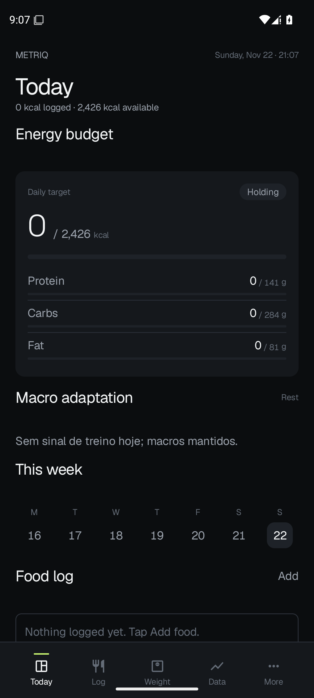
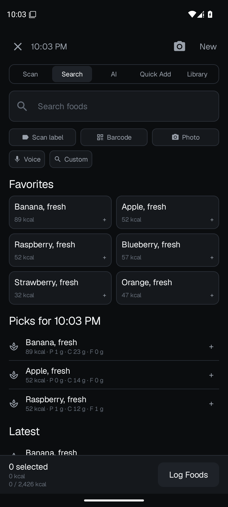
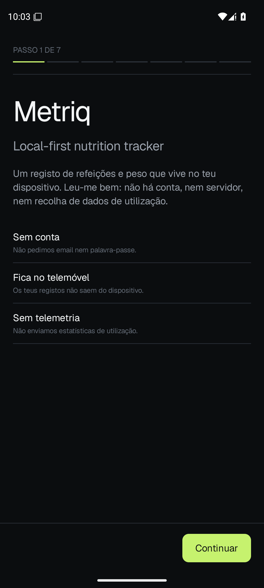
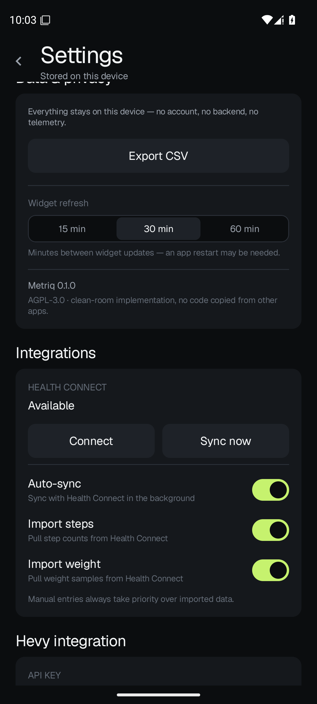

<div align="center">


[](https://github.com/TheusHen/metriq/actions/workflows/android-crash-log.yml)
[](LICENSE)
[](https://kotlinlang.org)
[](https://developer.android.com)
[](#privacidade-de-verdade)
[](https://github.com/TheusHen/metriq/pulls)

**Seus números. Suas metas. Seu aparelho.**

</div>

---

## A ideia

A maioria dos apps de nutrição pede uma conta, envia seus dados para a nuvem e calcula metas com uma fórmula genérica que ninguém vê. O **Metriq** faz o contrário: tudo acontece no seu celular. Sem login, sem backend, sem telemetria — e com a matemática aberta para auditoria.

Você diz **o que quer alcançar e até quando**. O Metriq descobre o resto: seu gasto real a partir das calorias que você come e da sua tendência de peso, converte o prazo em calorias diárias, monta os macros e avisa quando o ritmo pedido é agressivo demais. Se você se pesa uma vez por semana em vez de todo dia, o cálculo continua certo.

> Feito para quem quer precisão sem entregar privacidade.

<div align="center">

| Hoje | Registrar alimento | Analytics |
|:---:|:---:|:---:|
|  |  |  |

| Onboarding inteligente | Código de barras | Integrações |
|:---:|:---:|:---:|
|  |  |  |

</div>

## Por que o Metriq é diferente

- **Gasto de verdade, não uma fórmula engessada.** O Metriq usa a identidade do balanço energético (calorias entrando − energia armazenada = calorias saindo), com 7716 kcal/kg. A variação de peso é distribuída entre as pesagens reais — intervalos de 1, 3, 7 ou 14 dias dão o mesmo resultado correto.
- **BMR com fórmulas publicadas.** Mifflin-St Jeor para peso/altura/idade/sexo e Katch-McArdle quando você informa gordura corporal. Sem descontinuidade artificial no aniversário de 60 anos.
- **Wizard que entende prazos.** Escolha peso-alvo e "até quando": ele mostra ao vivo as calorias necessárias, o ritmo em kg/semana, a data prevista e um aviso se você passou do referencial seguro (0,5 kg/semana para adultos).
- **A meta acompanha os dados.** Se chegam novos pesos do Health Connect, o alvo é recalculado a partir do gasto atual — a meta não fica travada no número digitado no primeiro dia.
- **Saúde conectada sem duplicar calorias.** Peso, passos, calorias ativas e sessões do Health Connect alimentam BMR, tendência e sinal de treino. Calorias ativas nunca são somadas ao gasto, porque a diferença ingestão–peso já contém sua atividade.
- **Macros que fecham a conta.** Proteína, gordura e carboidrato somam as calorias da meta — inclusive em cortes agressivos de 1200 kcal, onde outros apps estouram o alvo em 12%.

## O que já funciona

- Tendência de peso → gasto → orçamento semanal → macros, tudo a partir de dados locais.
- Busca de alimentos offline, código de barras, OCR de rótulos e rotulagem de fotos no aparelho.
- Registro por hora, alimentos customizados, receitas simples, quick add e log por voz.
- Perfil, check-in semanal, exportação CSV e tela **Data** com 10 métricas, filtros e scrubbing.
- Micronutrientes com DRI (incluindo valores femininos), medidas corporais, fotos de progresso, ciclo, hábitos com streak, passos e água.
- Health Connect (leitura) e Hevy (leitura), com backfill e sincronização via WorkManager.
- Três widgets Glance, tema claro/escuro, tipografia Geist + Space Grotesk, reduced motion e i18n em EN/PT-BR/ES.

## Privacidade de verdade

| | |
|---|---|
| Conta obrigatória | ❌ |
| Backend próprio | ❌ |
| Telemetria | ❌ |
| Dados de saúde no app | ✅ locais, criptografados quando aplicável |
| Chave do Hevy | ✅ `EncryptedSharedPreferences` + Keystore |
| Backup de dados | ✅ CSV exportado pelo próprio usuário |
| Licença | AGPL-3.0 |

O Metriq declara permissão de internet apenas para as integrações opt-in (Hevy, busca online e download de modelos). O núcleo funciona 100% offline.

## Começando

Requisitos: **JDK 21**, Android SDK platform 36 + build-tools 36.0.0.

```powershell
.\gradlew.bat test assembleDebug
python -m pytest metriq-foodpacks/tests -q
```

O APK debug fica em `app/build/outputs/apk/debug/app-debug.apk`.

### Arquitetura

| Módulo | Conteúdo |
|---|---|
| `core-domain` | BMR, tendência, gasto, metas, macros, DRI, parser de rótulos — Kotlin puro na JVM |
| `core-data` | SQLDelight, FTS5, repositories, notificador de mudanças |
| `app` | Compose, CameraX/ML Kit, Health Connect, Glance, WorkManager |

A CI roda testes JVM e do pipeline de food packs, captura telas em emulador e **falha** se aparecer um sinal real de crash/ANR no logcat.

## Estado do projeto

- **Versão:** 0.1.0 — em desenvolvimento ativo.
- **Já validado:** 373 execuções de testes JVM (0 falhas) + 24 testes do pipeline Python; probes numéricos independentes conferem BMR, gasto com pesagens esparsas e soma de macros.
- **Ainda não feito:** download de food packs pela UI, análise de fotos na nuvem (só on-device), escrita de dados no Health Connect e execução em dispositivo físico (a CI usa emulador).

## Contribuindo

Issues e PRs são bem-vindos — especialmente em acessibilidade, i18n, pipeline de alimentos e testes de UI. A matemática fica em `core-domain`, com testes JUnit para cada fórmula; mexa lá e rode `.\gradlew.bat :core-domain:test`.

## Créditos e licença

- Dados de alimentos: **USDA FoodData Central** (CC0) e **Open Food Facts** (ODbL — atribuição necessária).
- Fontes: **Geist** e **Space Grotesk** (SIL OFL).
- Código: **AGPL-3.0** — veja [LICENSE](LICENSE).

Clean-room: nenhum código, asset, fonte ou marca de outros apps de nutrição foi usado.

---

<div align="center">

Feito com dados locais e matemática verificada.

[⬆ Voltar ao topo](#a-ideia)

</div>
