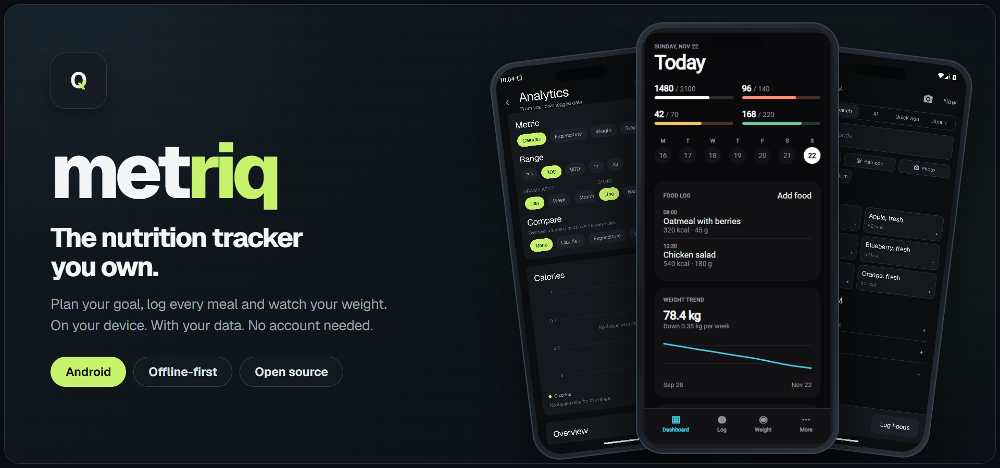
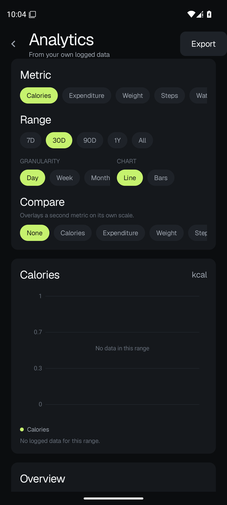
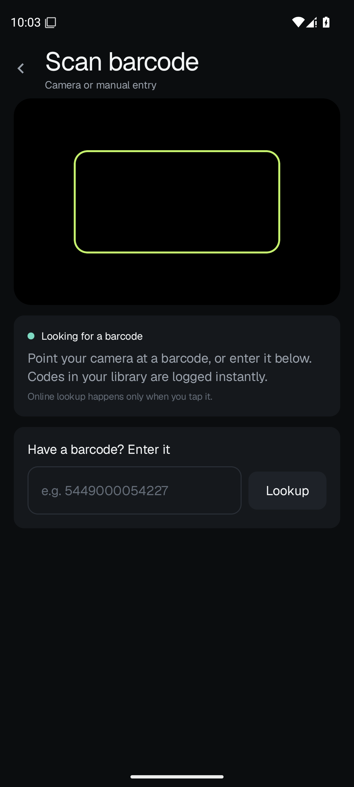

<div align="center">



[](https://github.com/TheusHen/metriq/actions/workflows/android-crash-log.yml)
[](LICENSE)
[](https://kotlinlang.org)
[](https://developer.android.com)
[](#privacy-by-design)
[](https://github.com/TheusHen/metriq/pulls)

**Your numbers. Your goals. Your device.**

</div>

---

## The idea

Most nutrition apps ask for an account, send your data to a server, and calculate your targets with a generic formula nobody can inspect. **Metriq does the opposite**: everything happens on your phone. No login, no backend, no telemetry — and the math is open for audit.

You say **what you want to achieve and by when**. Metriq figures out the rest: your real expenditure from the calories you eat and your weight trend, turns your deadline into daily calories, builds your macros, and warns you when the requested pace is too aggressive. Weigh yourself once a week instead of every day? The calculation stays correct.

> Built for people who want precision without giving up privacy.

<div align="center">

| Today | Add food | Analytics |
|:---:|:---:|:---:|
|  |  |  |

| Smart onboarding | Barcode scanner | Integrations |
|:---:|:---:|:---:|
|  |  |  |

</div>

## Why Metriq is different

- **Real expenditure, not a hard-coded formula.** Metriq uses the energy-balance identity (calories in − stored energy change = calories out) at 7716 kcal/kg. Weight change is spread across the real weigh-in dates — gaps of 1, 3, 7 or 14 days all return the same correct answer.
- **BMR from published equations.** Mifflin-St Jeor for weight/height/age/sex and Katch-McArdle when you provide body fat. No artificial discontinuity at your 60th birthday.
- **A wizard that understands deadlines.** Pick a target weight and "by when": it shows live daily calories, the pace in kg/week, the projected date, and a warning if you pass the safe reference (0.5 kg/week for adults).
- **Goals follow the data.** When new weights arrive from Health Connect, the target is recomputed from current expenditure — it doesn't stay pinned to the number you typed on day one.
- **Health data connected without double counting.** Weight, steps, active calories and exercise sessions from Health Connect feed BMR, trend and the training signal. Active calories are **never added** to expenditure, because the intake-minus-weight difference already contains your activity.
- **Macros that add up.** Protein, fat and carbs sum to your calorie target — even in an aggressive 1200 kcal cut, where other apps overshoot by 12%.

## What works today

- Weight trend → expenditure → weekly budget → macros, all from local data.
- Offline food search, barcode, label OCR and on-device photo labeling.
- Hourly food log, custom foods, simple recipes, quick add and voice logging.
- Profile, weekly check-in, CSV export and a **Data** screen with 10 metrics, filters and scrubbing.
- Micronutrients with DRI (including female values), body measurements, progress photos, cycle tracking, habits with streaks, steps and water.
- Health Connect read **and opt-in meal/nutrient write**, periodic background sync, Hevy (read), historical backfill and daily reminders.
- Full local JSON backup/restore of every table, and an in-app manager to download, update and remove offline food packs.
- Three Glance widgets, light/dark theme, Geist + Space Grotesk typography, reduced motion and full EN/PT-BR/ES translations (including all domain warnings).

## Privacy by design

| | |
|---|---|
| Account required | ❌ |
| Custom backend | ❌ |
| Telemetry | ❌ |
| Health data | ✅ on-device, encrypted where applicable |
| Hevy API key | ✅ `EncryptedSharedPreferences` + Keystore |
| Backup | ✅ full local JSON export / restore, no cloud |
| License | AGPL-3.0 |

The app declares INTERNET only for opt-in integrations (Hevy, online food search, model downloads). The core works fully offline.

## Getting started

Requirements: **JDK 21**, Android SDK platform 36 + build-tools 36.0.0.

```powershell
.\gradlew.bat test lint assembleDebug
python -m pytest metriq-foodpacks/tests -q
```

Debug APK: `app/build/outputs/apk/debug/app-debug.apk`.

### Architecture

| Module | Contents |
|---|---|
| `core-domain` | BMR, trend, expenditure, goals, macros, DRI, label parser — pure Kotlin on the JVM |
| `core-data` | SQLDelight, LIKE-based search, repositories, change notifier |
| `app` | Compose, CameraX/ML Kit, Health Connect, Glance, WorkManager |

Food search uses `LIKE` over the food table: Android's system SQLite does not always ship the FTS5 extension (e.g. Samsung/One UI), so the app avoids FTS5 to keep search working on all supported devices.

CI runs JVM and food-pack pipeline tests, Android lint, captures screens on an emulator, and **fails** on real crash/ANR signals in logcat.

## Project status

- **Version:** 0.1.0 — under active development.
- **Validated:** 373 JVM test executions (0 failures) + 24 Python pipeline tests; independent numeric probes confirm BMR, expenditure with sparse weigh-ins, and macro energy sums.
- **Not done yet:** cloud photo analysis (recognition is on-device only) and a physical-device run (CI uses an emulator). Food-pack downloads and Health Connect meal writes are opt-in.

## Contributing

Issues and PRs are welcome — especially accessibility, i18n, the food pipeline and UI tests. The math lives in `core-domain` with a JUnit test per formula; change it there and run `.\gradlew.bat :core-domain:test`.

## Credits and license

- Food data: **USDA FoodData Central** (CC0) and **Open Food Facts** (ODbL — attribution required).
- Fonts: **Geist** and **Space Grotesk** (SIL OFL).
- Code: **AGPL-3.0** — see [LICENSE](LICENSE).

Clean-room: no code, assets, fonts or trademarks from other nutrition apps were used.

---

<div align="center">

Built with local data and verified math.

[⬆ Back to top](#the-idea)

</div>
